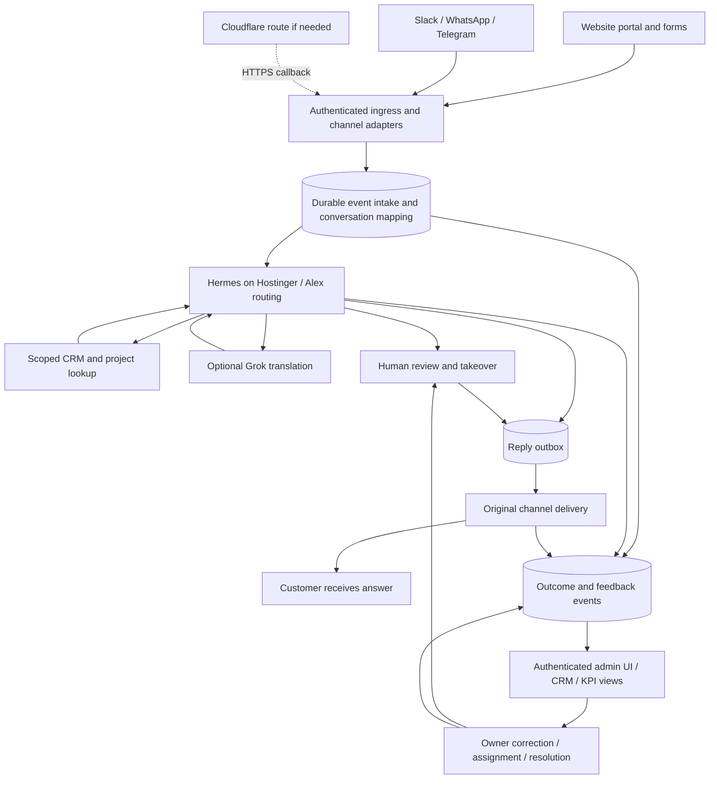

# Cloud connectivity and admin feedback brief

Updated 2026-10-27. Working architecture for the owner's next screenshot review. No deployment, installation, schema change, message sending, or UI implementation performed. The diagram and contracts below are proposals.

## Known context and unresolved details

| Item | Evidence | Next detail needed |
|---|---|---|
| Tizen Kitchen on a Cloudflare domain | Owner-reported; spelling retained as supplied | Exact hostname, Cloudflare service, origin, and whether this is a separate client engagement. |
| Slack connections exist | Owner-reported; local MGC relay code exists | Workspace/app/channel ownership and verified current event path. |
| WhatsApp connections exist | Owner-reported, superseding older “planned connection” notes | Provider, account/number ownership, bridge versus Business API, and supported send/receive behavior. |
| Hermes on Hostinger VPS | Existing `cloud.md` direction; owner says installation is forthcoming | Host, version, installed/configured/running state. |
| MGC production website | Repository guidance specifies Netlify | Confirm live deployment separately; Cloudflare context does not imply moving the site. |
| CRM/database targets | `cloud.md` records an unresolved Notion workspace location and Supabase connection mismatches | Verify the intended workspace/project and record ownership before connecting customer-context tools; no live data connection was validated here. |
| Customer feedback in admin / CRM / KPI UI | Owner requirement | Screenshot-selected target page, theme, and priority actions. |
| Zernio (zernio.com) | Owner began onboarding 2026-10-27; see [channel-accounts-review-2026-10-27.md](reference/channel-accounts-review-2026-10-27.md) | Owner decision: adopt as the WhatsApp/SMS/voice channel adapter instead of (or alongside) the DIY Hermes + Telegram Bot API + WhatsApp Business Cloud API plan. No account/number connected yet. |

Until ownership is confirmed, treat Tizen Kitchen as a separate engagement scope. Do not copy MGC staff identities, customer data, credentials, or permissions into it. Use an explicit business/tenant mapping established by trusted configuration, not a tenant identifier supplied freely by a chat message.

## Proposed connection map

Hermes may host channel adapters itself. This is a logical map, not a requirement for another gateway per platform. Select a verified ingestion hook before choosing where durable intake lives; do not assume Hermes already supplies the proposed CRM event store, outbox, or analytics. For Slack, preserve the current relay until one replacement or coexistence path has been tested.

For the persona hierarchy, per-channel build status, and the guardrail gates in execution order (the "what stops bad output before a customer sees it" view, for the eventual VPS install), see [agent-guardrail-architecture-2026-10-27.md](reference/agent-guardrail-architecture-2026-10-27.md).

## Connection contracts

| Connection | Required information and behavior |
|---|---|
| Channel → intake | Verify provider or portal authentication; derive business scope; carry channel/account, external event/message/thread IDs, received time, attachment references, and correlation ID. Deduplicate before processing; acknowledge callbacks after durable acceptance, independently of model work. |
| Intake → customer context | Resolve verified identity and conversation ownership. Unknown senders get public service information and intake, not private client records. Preserve source/target language and original/translated text. |
| Alex → answer | Retrieve current authoritative facts with record references and retrieval time. Missing or conflicting facts cause clarification or escalation. Do not invent project status, prices, availability, or commitments. |
| Answer → delivery | One reply owner; `ai`, `human`, and `closed` conversation modes remain enforced. Track queued, provider-accepted, confirmed-delivered where supported, failed, and unknown states separately. Use bounded retries and flag ambiguous delivery before resending. |
| Processing → admin | Correlated events for receipt, routing, lookup outcome, reply, escalation, delivery, and explicit feedback. Include model/version, cost when known, duration, and sanitized error category. |
| Admin → follow-up | Record owner, action, reason, timestamp, and expected outcome for assign, take over, correct, retry, or resolve. Persist actions through an authorized backend; UI events alone are not durable records. |

Keep a client's answer separate from internal commentary. A correction becomes a reviewed task or knowledge change with provenance; it must not automatically overwrite approved CRM facts or alter every future reply. Each channel's outage should remain visible without blocking other channels.

## Admin experience to shape with screenshots

Start from the existing [command center handoff](../../docs/command-center.md), `command-center.html`, `assets/command-center.js`, and `crm.html`. The current JS uses `mgc_agent_events`, `mgc_approvals`, `mgc_model_usage`, `mgc_leads`, `mgc_tasks`, and related tables and emits `cc:event`, `cc:render`, and `cc:view`. Reuse suitable structures after checking the actual schema and authorization; these names are not a claim that all proposed fields exist.

Proposed screen organization:

1. **Overview:** waiting customers, oldest unanswered request, first-answer time, confirmed outcomes, and channel health. Every card shows period and freshness.
2. **Conversation inbox:** channel/customer filters, assigned role, language, last response, waiting time, and human/AI ownership. A detail drawer shows the conversation, source records, translation, delivery status, and owner actions.
3. **Needs attention:** missing information, customer complaints, failed deliveries, uncertain translations, and repeated questions. Owner can assign, add a correction, or take over.
4. **Connections:** configured/running/connected states, last successful inbound/outbound event, and actionable failures. Never label a saved token “healthy.”
5. **CRM and performance:** inquiries by intent, conversion where attributable, costs, and feedback trends, each linked to underlying records.

Visual evidence differs: `crm.html` has navy/cyan/gold tokens; `command-center.html` loads `command-center-glass.css` after the base CSS, and that override now specifies a light blue/silver/white/gray palette with Roboto and rounded cards. The older handoff still describes dark glass. Do not decide the theme from filenames or stale notes; use the owner's screenshots to choose the reference. Preserve readable charts, keyboard navigation, status text beyond color, and restrained motion. No new frontend framework is required.

## KPI definitions for the first implementation

All metrics must filter by business, channel, and date window; display coverage and `not available` when required evidence is missing. Compute period aggregates server-side across the full authorized dataset. The existing dashboard's latest-1000-row lists and SAMPLE fallback cannot establish production totals or latency.

| Metric | Definition |
|---|---|
| Waiting for answer | Open conversations whose latest customer request has no substantive team/agent reply; automated receipts do not count. Show oldest waiting duration. |
| First-answer time | Median and p90 from first received customer request to first substantive provider-accepted reply for conversations initiated in the period; show answered count and still-waiting count separately. |
| Confirmed delivery rate | Confirmed-delivered messages divided by provider-accepted messages with delivery-receipt support in the outbound cohort; show pending/unknown separately. Unsupported channels show N/A. |
| Human escalation rate | Unique conversations escalated divided by unique conversations processed in the period, with counts. |
| Resolution | Count of conversations explicitly marked resolved by an authorized operator or explicit customer confirmation; label the source. Agent-generated completion claims alone do not count. |
| Customer helpfulness | Positive explicit ratings divided by all submitted ratings; show response count. Missing ratings are unknown, not negative. Keep inferred sentiment separate. |
| Owner corrections | Reviewed corrections grouped by cause and linked to conversation and follow-up task; never present a model confidence score as verified answer accuracy. |
| Cost per handled conversation | Recorded provider cost divided by unique processed conversations in the period; show missing-cost coverage and exclude unrelated usage. |

Separate `live`, `sample`, `stale`, and `unavailable` in the UI. Decorative heartbeat animation is not a service health measurement. Keep admin access server-enforced, including realtime subscriptions and cross-business filtering.

## Screenshot review and next slice

Screenshots are forthcoming, not yet received. For each image, record the visible application/page, hostname if shown, theme cues, existing connections, data ownership, and desired action. A screenshot can prove what is displayed, not backend delivery or database correctness. Do not retain visible credentials in documentation.

First implementation slice after clarification: one existing channel → one verified customer/prospect request → grounded answer or human escalation → delivery outcome → one admin conversation detail and attention card. Test wrong-client access, duplicates, disconnect/retry, and missing data before expanding to more channels and voice. Track the work in [COMMUNICATIONS-FOLLOW-UP.md](COMMUNICATIONS-FOLLOW-UP.md).
