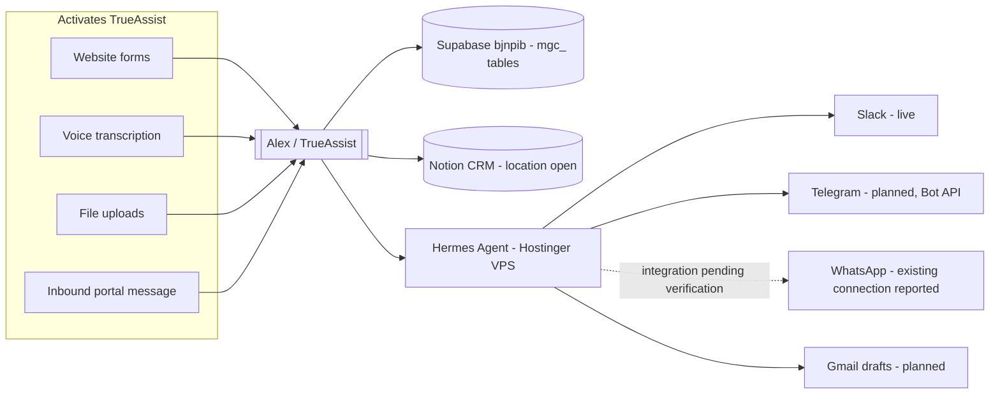

# Cloud Notes

## Communication Portals & System Map

Last updated: 2026-10-27. Read this section first — everything below is supporting detail.

**Communication context:** the owner reports existing Slack and WhatsApp connections (2026-10-27). Earlier notes describe Slack as live; WhatsApp's provider/account and two-way behavior have not been verified here. Telegram and Gmail automation remain planned. The recorded Hermes deployment direction is a Hostinger VPS; an existing channel connection does not establish Hermes integration. The historical `project_grok_voice_hermes_integration.md` memory reference has not been located in this workspace.

**Tizen Kitchen / Cloudflare:** the owner reports Tizen Kitchen is placed on a Cloudflare domain. Exact hostname, Cloudflare service (DNS/proxy, Pages, Workers, or Tunnel), origin host, and relationship to MGC remain unconfirmed. This does not change the Hostinger plan or MGC's Netlify production hosting. Keep Tizen Kitchen's records and credentials scoped separately until ownership and access are established.

See the [official Hermes source guide](agentic-staffing/alex-trueassist-orchestrator/reference/hermes-agent.md) and [cloud connectivity / admin feedback brief](agentic-staffing/alex-trueassist-orchestrator/CLOUD-CONNECTIVITY-AND-FEEDBACK.md) for the proposed connection map, screenshot follow-up, and KPI definitions.

- **Telegram** uses the Telegram **Bot API** (plain HTTPS, `api.telegram.org/bot<token>/...`) — not TDLib (`github.com/tdlib/td`, the C++ library behind full Telegram client apps like Telegram Desktop). TDLib was considered as reference/education material only and deliberately **not cloned** into this repo. If it's ever needed for protocol study, it belongs in its own folder **outside** `mgc-site-complete_1/`, not as a project dependency — flag here so it isn't re-litigated.
- **WhatsApp** has an existing connection according to the owner. Inventory that connection before building or replacing anything: identify provider, business account/number, inbound path, delivery callbacks, and ownership. Hermes documents both a WhatsApp bridge and a separate Business Cloud API adapter; choose the compatible path after verification. Hermes wiring remains unverified.
- **Slack** is already live — see `netlify/functions/trueassist.js` and `slack-events.js`.
- **Trigger surfaces** that activate TrueAssist: website form submissions (`lead-intake.js`, `trueassist.js`), voice transcription (planned Grok Voice bridge), file uploads (`mgc_uploads`), and any inbound message on a connected portal.

### Where everything actually lives (source of truth)

| System | What it is | Where / ID | Status |
|---|---|---|---|
| Supabase — MGC (real) | Client portal DB, `mgc_*` tables | `bjnpibxaxlgvlzeegwnm` → https://bjnpibxaxlgvlzeegwnm.supabase.co | Live — use this one |
| Supabase — dead ref | — | `zppuzfvchqxkzprfkhfz` | DNS dead. **This session's Supabase MCP tool connects here, not bjnpib** — don't trust its query results for MGC data until it's reconnected |
| Supabase — LoveLi (wrong) | Another client's DB | `lphudfgjbsyhroqmhomh` | MGC's Netlify env `SUPABASE_ANON_KEY`/`SERVICE_ROLE_KEY`/`DATABASE_URL` mistakenly point here — known unresolved bug |
| Notion CRM | Companies/Contacts/Deals/Projects/Invoices DBs | **Unknown — open question** | The Notion MCP connected in this session is workspace "Mark Cartwright's Space" and is empty (just the default "Getting Started on Mobile" page). The real CRM databases (referenced only by ID via `NOTION_*_DATABASE_ID` env vars) live somewhere else. Need the actual Notion workspace name/account or a page URL from the owner to locate it. |
| Netlify (production) | Live site | `mgc-global-consulting`, `07dc7dd7-37b2-4044-8503-64e8ca7a9044`, mgcglobalconsulting.com | Live — manual deploy only (`netlify deploy --prod`), not git-linked |
| Vercel (preview) | Dev/test mirror | `mgc-site-complete-1`, scope `onedopestorys-projects` | Preview/testing only, not production |
| GitHub — work repo | Actual source, wired to Vercel | `OneDopeStory/mgc` via `onedope` remote | Current |
| GitHub — origin | Stale stub | `mgcglobalconsulting/mgc-site-complete_1` | 1-line README only, not the work branch |
| Slack | Owner notifications | `SLACK_WEBHOOK_URL` / `SLACK_BOT_TOKEN` env vars | Live |
| Telegram | Portal | Bot API via Hermes Agent (Hostinger VPS) | Planned |
| WhatsApp | Portal | Existing connection; provider/account unknown | Owner-reported connected; Hermes integration unverified |
| Tizen Kitchen | Cloudflare domain | Exact hostname, service and origin unknown | Owner-reported; engagement relationship unconfirmed |
| Gmail | Draft creation for owner/staff | OAuth via Hermes | Planned |
| Stripe | Payments | `STRIPE_*` env vars | Live |
| QuickBooks | Invoicing | `request-invoice.js` | Live — client secret exposure is a separate open security item, see root `CLAUDE.md` |
| Google Calendar | Booking source of truth | `GOOGLE_*` env vars | Live |

### Intended connections (not a verified live topology)

## Supabase Glossary Review

Source: https://supabase.com/docs/guides/resources/glossary
Reviewed: 2026-06-04

The Supabase glossary is a quick reference for auth, identity, token, and security language used across Supabase docs. For this repository, the most relevant connection is `dashboard.html`, which uses Supabase browser auth and realtime subscriptions.

### Core Takeaways

- Authentication (`authn`) verifies who a user is.
- Authorization (`authz`) verifies what an authenticated identity is allowed to access.
- A browser session is represented by an access token plus a refresh token.
- Access tokens are short-lived JWTs, commonly valid for no more than about 1 hour.
- Refresh tokens are long-lived and are exchanged through the refresh token flow to renew access.
- JWTs carry identity and authorization information, and Supabase RLS policies can use JWT claims to decide row access.
- The JWT signing secret is highly sensitive. Anyone with it can create arbitrary JWTs, so it must never be exposed publicly or placed in client-side code.
- Row Level Security (RLS) policies are Postgres objects that control which rows and operations clients can access.
- OAuth is commonly used for social login. OIDC and SAML are common enterprise SSO protocols.
- PKCE protects OAuth flows for SPAs, mobile apps, and other clients where token exchange could be intercepted.
- MFA/2FA combines multiple identity factors. TOTP is the app-generated one-time password style used by authenticator apps.
- Nonces are unique, hard-to-guess values used to initialize secure flows or reduce replay attack risk.
- Password hashing functions such as Argon2, bcrypt, and scrypt let servers verify passwords without storing plaintext passwords.

### Memory Hook For This Site

When working on the MGC client portal or Supabase auth:

- Treat the anon key as browser-safe, but never expose service-role keys or JWT signing secrets.
- Keep RLS policies aligned with JWT/session identity.
- Remember that login proves identity, but RLS and policies still need to prove permission.
- Use PKCE-aware OAuth patterns for browser/mobile-style flows.
- Watch refresh-token behavior when debugging "logged out", stale session, or token renewal issues.

## Supabase External IDs / Notion Sync

Recorded: 2026-06-05

Use Supabase UUIDs as canonical Notion external IDs so Zapier, Make, n8n, or webhook services can upsert instead of duplicate records.

- Supabase project: `bjnpibxaxlgvlzeegwnm` (`https://bjnpibxaxlgvlzeegwnm.supabase.co`)
- Main identity key: `mgc_client_profiles.id` equals the Supabase Auth user UUID.
- Relationship key: `client_id` should point back to `mgc_client_profiles.id` / `auth.users.id`.
- Contact fallback key: `email`; use only when a Supabase UUID is unavailable.
- Avoid matching on names, company labels, or display text except for human-readable relations.
- Current Supabase-to-Notion webhook: `mgc_client_profiles` `INSERT` -> `/.netlify/functions/new-client-signup`.
- Webhook auth: `Authorization: Bearer {SUPABASE_WEBHOOK_SECRET}`.
- Do not expose service-role keys, JWT secrets, or webhook secrets to client-side code or Notion pages.

Canonical table keys:

- `mgc_client_profiles`: `id`, fallback `email`.
- `mgc_projects`: `id`, relation `client_id`.
- `mgc_deliverables`: `id`, relations `client_id`, `project_id`.
- `mgc_invoices`: `id`, relation `client_id`, business key `invoice_number`, payment key `stripe_payment_intent_id`.
- `mgc_bookings`: `id`, fallback `email`; next fix should add `client_id` on insert from `dashboard.html`.
- `mgc_messages`: `id`, relation `client_id`.
- `mgc_uploads`: `id`, relation `client_id`, file pointer `file_url`.
- `mgc_questionnaires`: `id`, relation `client_id`.

Note: `onboarding-assistant.html` does not call Supabase directly. It posts to `/.netlify/functions/lead-intake`, which writes to Notion directly.

## MGC email handoff for Hermes (2026-10-26)

Staff-specific templates and local starter drafts are prepared in `agentic-staffing/*/emails/`. Use [Alex’s email workflow](agentic-staffing/alex-trueassist-orchestrator/emails/AUTOMATION.md) when setting up Hermes in the cloud. It defines confirmed-onboarding draft creation, CRM promotion drafts, and owner updates through Slack/Telegram/Gmail. Destination IDs, mailbox authorization, cloud runtime, durable storage, and event subscriptions are still pending. No cloud automation or delivery was enabled by creating this workspace.
